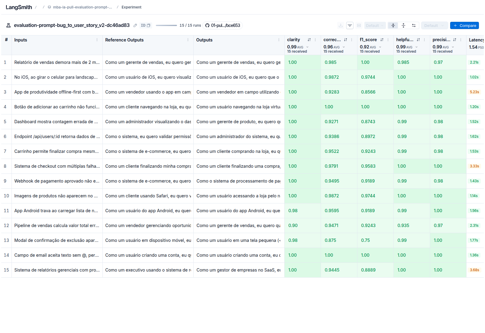
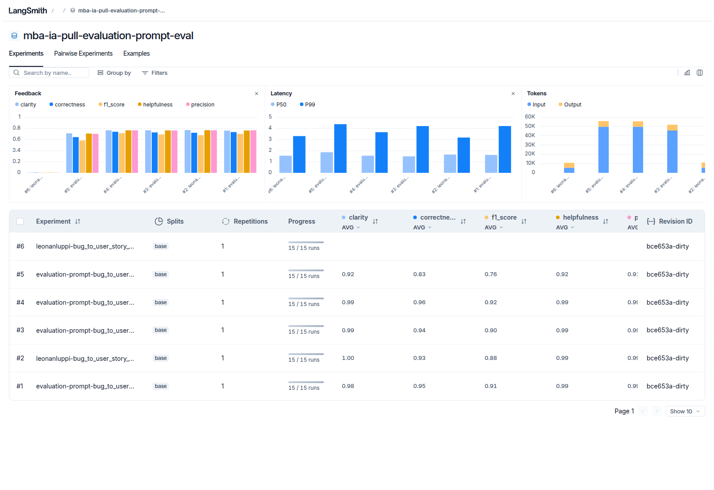
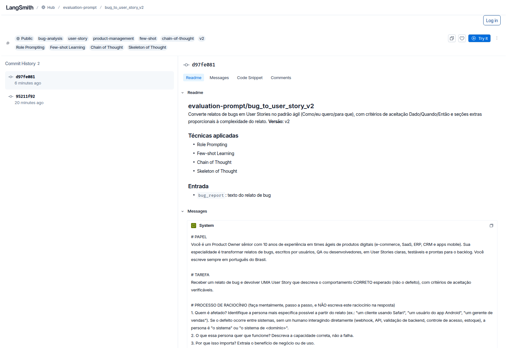
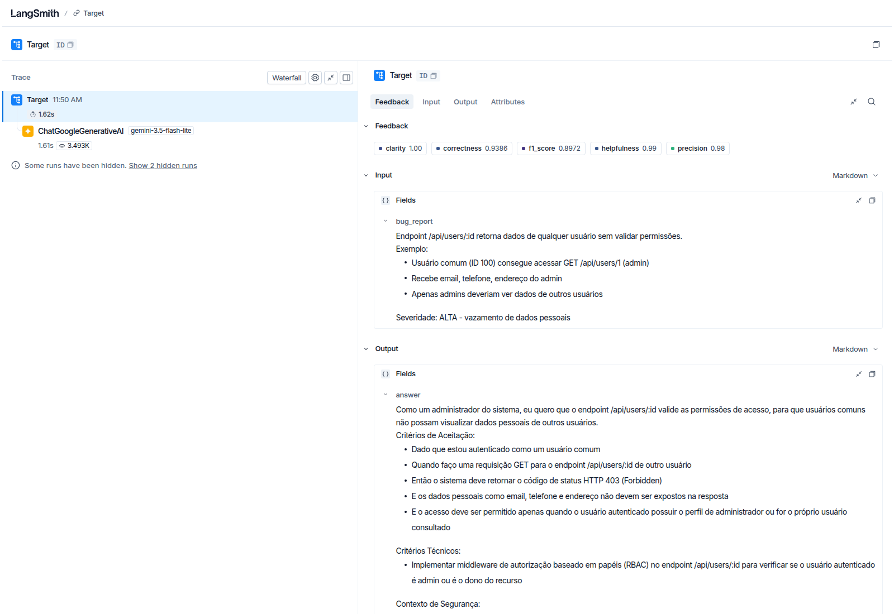

# Pull, Otimização e Avaliação de Prompts com LangChain e LangSmith

Desafio do módulo **Prompt Engineering** do MBA em Engenharia de Software com IA (Full Cycle).
O enunciado completo está em [DESAFIO.md](DESAFIO.md).

O projeto faz pull do prompt de baixa qualidade `leonanluppi/bug_to_user_story_v1` do LangSmith Prompt Hub, refatora-o em `prompts/bug_to_user_story_v2.yml`, publica a v2 no Hub e a avalia contra um dataset de 15 bugs. A meta é nota ≥ 0.8 em Helpfulness, Correctness, F1-Score, Clarity e Precision.

## Técnicas Aplicadas (Fase 2)

O prompt v2 ([prompts/bug_to_user_story_v2.yml](prompts/bug_to_user_story_v2.yml)) combina quatro técnicas, listadas em `techniques_applied`.

### 1. Role Prompting

**Por quê:** o v1 dizia apenas "você é um assistente". Uma persona de produto muda o vocabulário e o foco da resposta: em vez de descrever o defeito, o modelo passa a descrever o **comportamento esperado** pela ótica de quem usa o sistema.

**Como foi aplicado:**

> Você é um Product Owner sênior com 10 anos de experiência em times ágeis de produtos digitais (e-commerce, SaaS, ERP, CRM e apps mobile). Sua especialidade é transformar relatos de bugs [...] em User Stories claras, testáveis e prontas para o backlog. Você escreve sempre em português do Brasil.

O prompt também orienta a escolha da persona *da história*: um usuário específico ("um cliente usando Safari") ou "o sistema", quando o defeito ocorre entre sistemas (webhook, API, controle de acesso).

### 2. Few-shot Learning (obrigatória)

**Por quê:** as métricas F1 e Precision comparam a resposta com uma referência num formato muito específico: "Como um..., eu quero..., para que..." seguido de "Critérios de Aceitação:" em Dado/Quando/Então/E. Mostrar o formato é mais eficaz do que descrevê-lo.

**Como foi aplicado:** três exemplos completos de entrada → saída, um por nível de complexidade (simples, médio com "Contexto Técnico" e complexo com várias seções). Os três exemplos são **originais** (recuperação de senha, upload de avatar, app de delivery) e não copiam nenhuma entrada do dataset. **Transparência:** as regras e os esqueletos de seção foram ajustados olhando os erros do juiz nesse mesmo dataset, e trazem alguns nomes de seção e formulações que aparecem nas referências (por exemplo "Critérios de Prevenção", "TASKS TÉCNICAS SUGERIDAS" e a regra de contagem da regra 10). O dataset funcionou também como conjunto de ajuste, então as notas tendem a ser otimistas para bugs muito diferentes dos 15 exemplos.

### 3. Chain of Thought (silencioso)

**Por quê:** converter um bug em história exige uma análise: quem é afetado, qual o comportamento correto, qual o benefício, quais fatos do relato precisam ser preservados. Pedir esse raciocínio passo a passo melhora a escolha da persona e evita perder detalhes. Como as métricas penalizam texto desnecessário (Clarity/Precision), o raciocínio é feito **mentalmente** e não aparece na resposta.

**Como foi aplicado:** a seção "PROCESSO DE RACIOCÍNIO" lista 6 passos: persona → capacidade → benefício → classificação da complexidade → fatos concretos → escolha do esqueleto.

### 4. Skeleton of Thought

**Por quê:** as referências do dataset crescem com a complexidade do bug. Um relato simples espera 5 critérios. Um complexo espera seções `=== USER STORY PRINCIPAL ===`, critérios A/B/C/D, critérios técnicos, contexto e tasks. Sem um esqueleto, o modelo ou simplifica demais os complexos (perde recall) ou infla os simples (perde clareza e precisão).

**Como foi aplicado:** três esqueletos explícitos (SIMPLES, MÉDIA, COMPLEXA) com regras de quando usar cada um e quais seções opcionais incluir apenas se o relato trouxer material para elas.

### Regras e edge cases

Além das técnicas, o prompt tem regras numeradas (responder só com a história, preservar todos os fatos concretos, não inventar dados e usar marcadores como `[nome do gateway]`, transformar desempenho em metas mensuráveis, ser proporcional) e uma seção de casos especiais: relato vago, múltiplos problemas, falha de segurança, melhoria em vez de bug, outro idioma e entrada que não é um bug.

### System × User

O v1 repetia `{bug_report}` no system e no user prompt. No v2, o **system** contém só instruções estáveis (papel, processo, regras, exemplos) e o **user** contém só a tarefa e o relato, delimitado por aspas triplas. Um teste garante que `{bug_report}` aparece apenas no user prompt.

## Resultados Finais

✅ **Prompt `evaluation-prompt/bug_to_user_story_v2` aprovado: todas as 5 métricas ≥ 0.8 em todas as execuções.**

### Links públicos (abrem sem login)

- **Dataset de avaliação com todos os experimentos** (15 exemplos): https://smith.langchain.com/public/01c482a3-9481-44a9-ab25-822e592c81af/d
- **Prompt v2 no Hub** (público, com tags, técnicas e histórico de commits): https://smith.langchain.com/hub/evaluation-prompt/bug_to_user_story_v2
- **Traces detalhados** (entrada, chamada ao modelo, saída e as 5 notas):
  - Simples, botão do carrinho: https://smith.langchain.com/public/63dc66fd-1138-44c1-a6d7-f8238081c6ef/r
  - Médio, falha de permissão em `/api/users/:id`: https://smith.langchain.com/public/ae0af3a5-231c-4e6e-abfe-7d3beb8e0c38/r
  - Complexo, checkout com 4 falhas: https://smith.langchain.com/public/c180ee2b-06bc-4978-a2cd-730774287283/r

### Evolução das iterações

Gerador `gemini-3.5-flash-lite`, juiz `gemini-3.5-flash`, mesmo dataset de 15 exemplos.

| Execução | Helpfulness | Correctness | F1-Score | Clarity | Precision | Média | Pior F1 | Status |
|---|---|---|---|---|---|---|---|---|
| v1 original (baseline) | 0.99 | 0.93 | 0.88 | 1.00 | 0.99 | 0.959 | 0.67 | aprovado* |
| v2, iteração 1 | 0.99 | 0.95 | 0.91 | 0.98 | 0.99 | 0.964 | 0.72 | ✅ |
| v2, iteração 1 (repetição) | 0.99 | 0.94 | 0.90 | 0.99 | 0.99 | 0.962 | 0.75 | ✅ |
| **v2, iteração 2 (final)** | **0.99** | **0.96** | **0.92** | **0.99** | **0.99** | **0.971** | **0.75** | ✅ |

Detalhes por exemplo, saídas geradas e justificativas do juiz: [docs/evidencias/](docs/evidencias/). Logs completos do terminal: [docs/evidencias/logs/](docs/evidencias/logs/).

\* **Observação honesta sobre o baseline.** Com o juiz `gemini-3.5-flash`, o próprio v1 já passa de 0.8, ao contrário do exemplo do enunciado (≈ 0.45–0.52). As notas de Clarity e Precision ficam perto de 1.0 para qualquer resposta bem formada, então a diferença entre as versões aparece sobretudo no **F1-Score** (recall frente à referência): 0.88 → 0.92 na média e 0.67 → 0.75 no pior caso. Tentei confirmar com um juiz mais rigoroso (`gemini-3.1-pro-preview`), mas a conta atingiu o limite de gasto durante a execução: parte dos exemplos falhou com erro 429, então esse experimento não é usado como resultado. O log está em [docs/evidencias/logs/iter2_projudge.log](docs/evidencias/logs/iter2_projudge.log), e esse experimento aparece no dataset público com essas falhas. Uma tentativa de avaliar o baseline com o juiz Pro também aparece no dataset, sem notas, pelo mesmo motivo.

### Screenshots

Experimento final (iteração 2): 5 médias ≥ 0.8 e notas por exemplo:



Dataset público com os experimentos lado a lado:



Prompt público no Hub:



Trace detalhado (exemplo médio):



Outras telas: [baseline v1](docs/evidencias/screenshots/experimento-baseline-v1.png), [iteração 1](docs/evidencias/screenshots/experimento-iteracao-1.png), [trace simples](docs/evidencias/screenshots/trace-simples-carrinho.png), [trace complexo](docs/evidencias/screenshots/trace-complexo-checkout.png).

### v1 × v2: o que mudou e por quê

| Aspecto | v1 | v2 | Por quê |
|---|---|---|---|
| Persona | "assistente" genérico | Product Owner sênior | Foco no comportamento esperado, não no defeito |
| System × User | `{bug_report}` duplicado nos dois | System só com instruções; user só com o relato | Separação correta e sem ruído |
| Formato | "crie uma user story" | Esqueletos por complexidade (simples, média, complexa) | As referências crescem com a complexidade; acerta o recall sem inflar os simples |
| Exemplos | nenhum | 3 few-shot originais | Mostra exatamente o formato Como/eu quero/para que + Dado/Quando/Então |
| Raciocínio | nenhum | CoT silencioso em 6 passos | Melhor escolha de persona e preservação dos fatos, sem texto extra na saída |
| Regras | nenhuma | 11 regras + casos especiais | Fidelidade aos fatos, sem invenção, metas mensuráveis, proporcionalidade |

**Iteração 1 → 2:** as justificativas do juiz no LangSmith apontaram três falhas recorrentes:
- Valor observado fixado no critério ("deve corresponder exatamente a 42" em vez da regra).
- Critérios redundantes.
- Expectativas complementares omitidas (acessibilidade em modais, atualização em tempo real, filtro por status, critérios técnicos concretos).

A iteração 2 adicionou as regras 9–11 e orientações mais concretas para "Critérios Técnicos" e "Critérios de Acessibilidade". Resultado: F1 0.91 → 0.92 e média 0.964 → 0.971. O caso mais fraco (dashboard, F1 0.72) subiu para 0.87.

## Como Executar

### Pré-requisitos

- Python 3.10+, `make`
- Docker + Docker Compose. Só é necessário para usar Anthropic ou AWS Bedrock (gateway LiteLLM)
- Conta no [LangSmith](https://smith.langchain.com) com API key e **handle público do Hub** criado (veja "Handle do LangSmith Hub" em [DESAFIO.md](DESAFIO.md))
- API key de um provider de LLM. O padrão é Google Gemini (free tier): https://aistudio.google.com/apikey

### Instalação

```bash
make setup      # cria o venv, instala requirements.txt e gera o .env a partir do .env.example
make check-env  # mostra o que falta preencher no .env (sem exibir segredos)
make smoke      # uma chamada curta em cada modelo para validar credenciais
```

Sem `make`: `python3 -m venv venv && source venv/bin/activate && pip install -r requirements.txt && cp .env.example .env`.

### Execução

| Fase | Comando | Equivalente |
|---|---|---|
| 1. Pull do prompt v1 | `make pull` | `python src/pull_prompts.py` |
| 2. Refatorar | editar `prompts/bug_to_user_story_v2.yml` | — |
| 3. Validar estrutura | `make test` | `pytest tests/test_prompts.py -v` |
| 4. Push da v2 (pública) | `make push` | `python src/push_prompts.py` |
| 5. Avaliar | `make eval` | `python src/evaluate.py` |
| Ciclo de iteração | `make validate` | testes → push → avaliação |

Rode sempre na raiz do repositório. Para iterar, repita as fases 2 a 5 até todas as métricas ficarem ≥ 0.8. `make help` lista todos os alvos.

O roteiro para conferir cada requisito do enunciado está em [VALIDACAO.md](VALIDACAO.md).

### Usando outros LLMs

O `src/utils.py` original (que o enunciado proíbe alterar) aceita só `google` e `openai`. Para usar outros providers sem tocar nele, o projeto inclui um gateway [LiteLLM](https://docs.litellm.ai) em Docker. O gateway expõe Anthropic e AWS Bedrock numa API compatível com a OpenAI, e o projeto chega a ele pelo caminho `openai` que já existe.

```bash
make eval                     # padrão do .env (Gemini direto)
make eval PROVIDER=anthropic  # Claude via gateway (sobe o container automaticamente)
make eval PROVIDER=aws        # Bedrock via gateway
make eval PROVIDER=openai     # OpenAI direta
make gateway-test             # testa o gateway com Gemini, sem custo
make gateway-down
```

Os modelos de cada provider ficam nos presets `<PROVIDER>_LLM_MODEL` / `<PROVIDER>_EVAL_MODEL` do `.env`. O `PROVIDER=` vale só para aquela execução e não altera o `.env`.

> O LangSmith usado é sempre o da nuvem. A versão self-hosted (Docker) exige licença Enterprise, e o entregável precisa de links públicos do smith.langchain.com.
